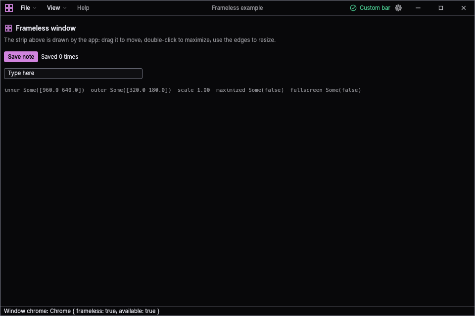
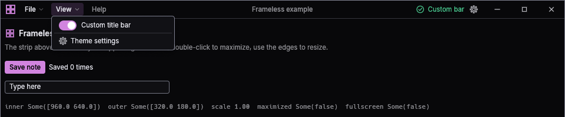
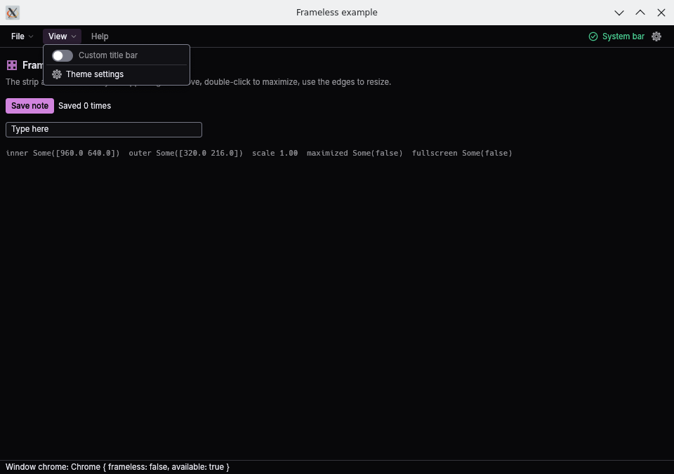

# Porting the custom title bar into an eframe app

The `title-bar` feature draws the window's top strip inside egui: a mark, your own content (a menu bar on the left, status on the right), the title, minimize / maximize / close buttons, a drag area and resize edges. The system title bar can be switched back on at any time, live or with a flag. This guide moves an existing eframe app over, step by step, and records what was and was not verified on real window managers.



`cargo run -p egui-theme-kit --example frameless --features title-bar` is a complete app that does everything below. It also runs with `-- --system-titlebar`.

## Checklist

1. Add the dependency with the `title-bar` feature (and `files` to remember the user's choice).
2. `chrome::resolve_from_process("my-app")` at startup, `chrome::viewport(...)` for the window.
3. `client_area::install(cc)` in the app creator (a no-op off Windows).
4. `egui_theme_kit::init(cc, ...)` as usual.
5. Replace the top menu panel with `TitleBar::show`, the menu bar goes in the left slot.
6. `window_edges(ui)` last in `App::ui`.
7. Offer `chrome::toggle_row` in a menu so the user can switch to the system bar.
8. Call `chrome::take_save_error` somewhere that can show a toast.

## 1. Dependency

```toml
[dependencies]
egui-theme-kit = { git = "https://github.com/shadowbrok3r/egui-theme-kit", default-features = false, features = ["title-bar", "files"] }
```

Pin a revision for reproducible builds: add `rev = "<commit>"`.

| Feature | What it gives the title bar |
|---|---|
| `title-bar` | `title_bar`, `chrome`, and on Windows the client-area fix. Implies `controls`. |
| `files` | The user's custom-or-system choice is saved to disk. Without it the choice lasts for the process. |
| `picker` | The theme picker window (the example's gear button opens it). |

Leaving `default-features = false` drops `glass`, `dock`, `toast`, `data-table`, `picker` and `files`; re-add what you use. `glass` switches eframe's `glow` backend on, so a wgpu app should leave it off.

On Windows the `title-bar` feature pulls in `windows 0.62` (features `Win32_Foundation`, `Win32_UI_Shell`, `Win32_UI_WindowsAndMessaging`) and `raw-window-handle 0.6`; nothing else changes for other targets.

The strip reads the kit's tokens, metrics and `medium` font family, so `egui_theme_kit::init(cc, KitConfig::default())` (or `init_context`) must have run before the first frame.

## 2. Startup: chrome, viewport, Windows fix

Before:

```rust
fn main() -> eframe::Result {
    eframe::run_native(
        "My App",
        eframe::NativeOptions {
            viewport: egui::ViewportBuilder::default().with_inner_size([1000.0, 700.0]),
            ..Default::default()
        },
        Box::new(|cc| Ok(Box::new(MyApp::new(cc)))),
    )
}
```

After:

```rust
use egui_theme_kit::{
    KitConfig,
    chrome::{self, Chrome},
    controls::icons,
    title_bar::{Side, TitleBar, window_edges, windows::client_area},
};

const APP_ID: &str = "my-app"; // names <config_dir>/my-app/window_settings.json

fn main() -> eframe::Result {
    let chrome = chrome::resolve_from_process(APP_ID);
    let viewport = chrome::viewport(
        egui::ViewportBuilder::default()
            .with_inner_size([1000.0, 700.0])
            .with_title("My App")
            .with_app_id(APP_ID),
        &chrome,
    );
    eframe::run_native(
        "My App",
        eframe::NativeOptions { viewport, ..Default::default() },
        Box::new(move |cc| {
            client_area::install(cc); // Windows only; returns true and does nothing elsewhere
            egui_theme_kit::init(cc, KitConfig::default());
            Ok(Box::new(MyApp::new(cc, chrome)))
        }),
    )
}
```

`MyApp` keeps the `Chrome` (two booleans: `frameless`, `available`).

- `chrome::viewport` turns the system decorations off when the chrome is frameless and gives the window a 360 x 200 minimum size unless the builder already sets one. It applies the minimum in both modes so a window switched to the custom bar later is still usable.
- `chrome::resolve_from_process` honours `--system-titlebar` and `EGUI_THEME_KIT_SYSTEM_TITLEBAR=1` for one launch without touching the saved choice. For your own argument or environment source use `chrome::resolve(app_id, args, |key| env_lookup(key))`.
- If the app can fall back to a software renderer that cannot drop the system decorations, use `Chrome::UNAVAILABLE` on that path. `toggle_row` then draws nothing and `set_frameless` does nothing.
- macOS is untested: removing the decorations removes the traffic-light buttons. Use `Chrome::UNAVAILABLE` there unless you handle that yourself.

### Where the choice is saved

| Platform | File |
|---|---|
| Linux | `~/.config/<app_id>/window_settings.json` |
| Windows | `%APPDATA%\<app_id>\window_settings.json` |
| macOS | `~/Library/Application Support/<app_id>/window_settings.json` |

The file is `{"custom_title_bar": true}`. A missing, empty or unreadable file means custom; writes go through a temporary file and a rename. To keep the file somewhere else (a machine-wide directory, say) use `ChromePrefs::load_from(path)` with `chrome::resolve_with(prefs, args, env)` and save with `ChromePrefs::save_to(path)` instead of `set_frameless`:

```rust
let prefs = ChromePrefs::load_from(&path);
let mut chrome = chrome::resolve_with(prefs, std::env::args().skip(1), |k| std::env::var(k).ok());
// later, when the user flips the switch
ctx.send_viewport_cmd(egui::ViewportCommand::Decorations(!on));
chrome.frameless = on;
let _ = ChromePrefs { custom_title_bar: on }.save_to(&path);
```

## 3. Moving the menu bar into the strip

Before (stock egui):

```rust
fn ui(&mut self, ui: &mut egui::Ui, _frame: &mut eframe::Frame) {
    egui::Panel::top("menu").show(ui, |ui| {
        egui::MenuBar::new().ui(ui, |ui| {
            ui.menu_button("File", |ui| {
                if ui.button("Quit").clicked() {
                    ui.send_viewport_cmd(egui::ViewportCommand::Close);
                }
            });
            ui.menu_button("View", |ui| { /* ... */ });
        });
    });
    egui::CentralPanel::default().show(ui, |ui| { /* ... */ });
}
```

After:

```rust
fn ui(&mut self, ui: &mut egui::Ui, _frame: &mut eframe::Frame) {
    let frameless = self.chrome.frameless;
    // The system bar already shows a title and icon, so only the custom one gets them.
    let mut bar = TitleBar::new("my_app.title_bar", if frameless { "My App" } else { "" })
        .frameless(frameless);
    if frameless {
        bar = bar.mark(icons::GRID); // any `controls::Icon`
    }
    bar.show(ui, |ui, side| match side {
        Side::Left => {
            ui.menu_button("File", |ui| {
                if ui.button("Quit").clicked() {
                    ui.send_viewport_cmd(egui::ViewportCommand::Close);
                }
            });
            ui.menu_button("View", |ui| {
                let _ = chrome::toggle_row(ui, &mut self.chrome, "Custom title bar");
            });
        }
        Side::Right => {
            ui.label("Ready"); // laid out right to left, before the caption buttons
        }
    });
    egui::CentralPanel::default().show(ui, |ui| { /* ... */ });
    if self.chrome.frameless {
        window_edges(ui);
    }
}
```

The `egui::MenuBar` wrapper goes; the `menu_button` calls move into the left slot as they are. Do not keep the wrapper: `MenuBar::ui` claims all the width it is offered, so the left slot would fill the strip, the title would be left out and no free space would be left to drag.



What `TitleBar` does:

- It is a top panel `Panel::top` of `Metrics::bar_h` points (36 at the default density). Declare it before any other panel.
- `.frameless(true)` adds the caption buttons at the right end and makes the free space between your content drag the window (double-click maximizes or restores). With `.frameless(false)` it is just a toolbar panel, so the same code serves the system-bar mode; pass an empty title and no mark there, as above.
- `show` runs your closure twice: for `Side::Right` first (right to left), then for `Side::Left` in what is left. Both closures get a child `Ui` that truncates text instead of wrapping. Keep the left content shrinkable; at the 360 pt minimum width the example keeps only File.
- The title is centred on the strip, slid to stay inside the free gap, and left out when it does not fit.
- The strip's drag area carries the `Role::TitleBar` accessibility role with the title as its label; each caption button is a labelled `Role::Button` ("Minimize", "Maximize" or "Restore down", "Close").
- Stock `ui.menu_button` and the kit's `controls::MenuButton` (with `menu_item`, `menu_separator`) both work in the slot; the kit's has a caret and padding. The example uses the kit's for File and View and a stock one for Help.
- Only the free space between the two ends drags the window. A non-interactive label in a slot is part of that slot, so it does not drag; keep the left content to the controls you need.

### Order inside `App::ui`

1. `TitleBar::show` first.
2. Your panels and content.
3. `window_edges(ui)` last, only while frameless. It adds the resize zones and a one-physical-pixel outline in a foreground layer and does nothing while maximized or fullscreen.

### What the resize zones cover

| Zone | Depth |
|---|---|
| left, right, bottom | `EDGE` = 8 pt |
| top | `TOP_EDGE` = 5 pt |
| corners | `CORNER` = 12 pt square |

Over empty space a press within egui's interact radius (5 pt by default) beyond a zone also resizes, so the reach is about 13 pt at the sides. Widgets that sit directly under the pointer outside the zone itself still win. The zones are cut away where the caption buttons are, except for a 3 pt margin along the window's top and right border, so the close button stays clickable right up to its top rows and the top-right corner still resizes. Content closer than `EDGE` to a side or the bottom (a status bar's buttons, a scrollbar) loses its outer rows to resizing; pad it or accept that.

## 4. Switching live

`chrome::toggle_row(ui, &mut chrome, "Custom title bar")` is a menu row with a switch. A click calls `chrome::set_frameless(ctx, &mut chrome, on)`, which updates `chrome.frameless`, sends `ViewportCommand::Decorations`, and saves the choice. The window switches even when saving fails; the error is kept for `chrome::take_save_error(ctx)`:

```rust
if let Some(error) = chrome::take_save_error(ctx) {
    self.toasts.error(format!("Couldn't save the title bar setting: {error}"));
}
```



The `Chrome` your app holds is the source of truth for what to draw (`TitleBar::frameless`, `window_edges`), so keep passing `self.chrome.frameless`.

How the window reacts to the switch, as observed under KWin:

- X11: the client area keeps its size and the frame grows by the title height (the client moves down by it).
- Wayland: KWin keeps the frame size and the client area shrinks by the title height.
- Windows, as seen under Wine only: the caption appears inside the same outer window rectangle and the client area shrinks by the caption and border (like KWin on Wayland).

## 5. Window title, taskbar and icon

The strip's text is only what you pass to `TitleBar::new`; the operating system's own title (taskbar button, Alt-Tab, task switchers, the title of a hidden-decoration window) comes from `ViewportBuilder::with_title` (or the `app_name` of `run_native` when none is set). Keep them in step: set both from the same string and update the OS title with `ctx.send_viewport_cmd(ViewportCommand::Title(..))` when the strip's changes. Set `with_app_id` so Wayland and X11 can match the window to a desktop entry, and `with_icon` for the taskbar icon; the strip's `mark` is only drawn inside the window.

## 6. Dialogs, popups and window position

- Menus, popups, tooltips, `egui::Window` and `egui::Modal` all live inside the window and are clamped to its content rectangle. Menus opened from the strip open under it on every backend tested and close on an outside click, on Escape and after an item click.
- `window_edges` sits in a foreground layer, so a popup that overlaps the border sits above it.
- Native dialogs (`rfd`, the picker's import and export) are separate windows and are unaffected.
- Window position is not available on Wayland (`ViewportInfo::outer_rect` is `None`, `OuterPosition` is ignored).
- Only the root viewport is covered. The strip and `window_edges` can be called inside another viewport's `ui`; that was not exercised.
- Fullscreen: the strip stays where it is. Hide it yourself while `ViewportInfo::fullscreen` is true if you want; `window_edges` already steps aside.
- eframe restores the saved window size and position at the next launch (`persist_window`). Switching between the two modes changes the frame, so the restored geometry can be a few pixels off in the other mode.

## 7. Platform notes

### Windows (primary target; not run on real Windows here)

- winit keeps the caption, border, system-menu and size-box style bits on an undecorated window so Aero Snap and the system move loop keep working, then removes the non-client area in `WM_NCCALCSIZE`. `ViewportCommand::StartDrag` and `BeginResize` start the system move and size loops, so dragging the strip should snap to screen edges like any window (the KWin equivalent was verified; Windows itself was not).
- egui-winit turns the DWM drop shadow on for an undecorated window by shifting the client rectangle down one pixel, which leaves its last row below the window. `client_area::install` clamps the client rectangle to the window, so `inner_rect` is one pixel shorter than the window (639 of 640 in the Wine run) and nothing paints outside it. This is the same subclass the original application used.
- While maximized, winit sizes the client area to the monitor's work area, so the taskbar is never covered. With an auto-hide taskbar the work area is the whole monitor; `install` additionally pulls the edge next to such a taskbar in by 2 pixels so the taskbar can still be revealed. This part is new and has not run on a real machine.
- DPI changes are handled by winit and egui; sizes in the strip are in points, so nothing is needed from the app.
- The Windows 11 maximize-button snap-layout flyout is not available: the maximize button is an egui widget, not an `HTMAXBUTTON` hit-test result. Win+arrow snapping and drag-to-edge should not depend on it (not verified on Windows).
- `client_area::install` returns `false` when the window is not a Win32 window or the subclass could not be installed; it is safe to call more than once. Call it from the app creator, before the first frame.
- Both `x86_64-pc-windows-msvc` and `x86_64-pc-windows-gnu` compile with the library; the example was cross-built for `-gnu` and started under Wine.

### Linux, X11

Moves and resizes go through `_NET_WM_MOVERESIZE`, so the window manager's own behaviour (edge tiling, snapping, restore-on-drag of a maximized window) applies. Verified under KWin only; GNOME (Mutter), Xfce, i3 and others were not run. No window-manager shadow or rounded corners were seen on the frameless window.

### Linux, Wayland

Moves and resizes use `xdg_toplevel.move` and `.resize`; the cursor shapes use `wp_cursor_shape_v1`. Switching to the system bar relies on the compositor's server-side decorations (`xdg-decoration`), which KWin offers; a compositor without them (GNOME) makes winit draw its own client-side frame, which was not tried.

### Egui's pointer state after a window-manager drag

While the window manager moves or resizes the window it owns the pointer, so egui sees the pointer leave and never sees the button release. egui then keeps the press, and the first click after the drag lands on the wrong widget or is lost. The library ends that press itself: when it sends `StartDrag` or `BeginResize` it registers a plugin that injects a release (preceded by a small pointer move so it is never a click) at the start of the next frame. Apps that send `StartDrag` or `BeginResize` from their own code should do the same; `title_bar` keeps the helper private.

## 8. What was verified

The example was driven through real window managers and every result below was read back from the system, not from the app: window geometry from `xdotool`, `xprop` and `org.kde.KWin.getWindowInfo`, pixels from screenshots. X11 under KWin 6.7.4: 54 of 54 checks pass. Wayland under `kwin_wayland --virtual`: 49 of 49 checks pass. All runs used software OpenGL (llvmpipe), eframe's `glow` backend, a private session and `WINIT_UNIX_BACKEND=wayland` for the Wayland runs. "pass" in a row means every check that belongs to the row passed.

| Check | X11 / KWin | Wayland / KWin | Notes |
|---|---|---|---|
| No system decoration while frameless | pass | pass | X11: no `_NET_FRAME_EXTENTS`, `_MOTIF_WM_HINTS` decorations 0. Wayland: frame equals the 960x640 content. |
| Minimum size set by `chrome::viewport` | pass | pass | X11: `WM_NORMAL_HINTS` 360x200. Wayland: a resize stops at 360 wide. |
| Drag on the strip moves the window, three times in a row | pass | pass | Also drags 2 and 3, which fail without the pointer handoff (the stale press swallowed them). |
| Double-click maximizes, again restores the same geometry | pass | pass |  |
| Drag on a maximized window restores it | pass | pass |  |
| Minimize button | pass | pass | Restored through `xdotool windowactivate` (X11) and a KWin script (Wayland). |
| Maximize / restore button follows the state | pass | pass | The restore glyph shows while maximized (screenshots). |
| Close button | pass | pass |  |
| Close button's top rows are not a resize zone | pass | pass |  |
| Edge and corner drags resize (8 directions) | pass | pass | East, west, south, north, SE, NW, NE, SW. |
| Resize stops at the minimum size | pass | pass | Width, then both axes (360 x 200). |
| Cursor over each zone | pass | pass | X11: cursor images compared with the Breeze theme. Wayland: `wp_cursor_shape_v1` shapes requested by the app. |
| File menu (kit `MenuButton`): opens under the strip, closes on outside click, Escape, item click | pass | pass |  |
| View menu (kit `MenuButton`, keeps open for its switch) | pass | pass |  |
| Help menu (stock `ui.menu_button`) and the egui `Window` it opens | pass | pass | The window opens inside the frameless window; the menu closes. |
| Live switch to the system bar adds decorations | pass | pass | X11: frame grows, client moves down 36 px. Wayland: frame keeps its size, client shrinks. |
| Live switch back removes them | pass | pass | Both directions, live and after a restart. |
| Choice saved and applied on the next launch | pass | pass | `window_settings.json` holds `{"custom_title_bar": false}` after the switch. |
| `--system-titlebar` and `EGUI_THEME_KIT_SYSTEM_TITLEBAR=1` | pass | pass | Neither touches the saved choice; without them the saved choice applies. |
| Scale factor 1.5 | pass | not verified | X11 via `WINIT_X11_SCALE_FACTOR=1.5`: strip drag, edge reach, maximize button hit area. Wayland: see below. |
| Fullscreen: fills the screen, edges inert, geometry restored | pass | pass | Entered and left through a KWin script. |
| Drag to a screen edge tiles the window | pass | pass | KWin's edge snap, the analogue of Aero Snap. |


Defects the runs found and the library now fixes:

- After a window-manager drag or resize the first click was lost or landed on the wrong widget (egui kept the press whose release the window manager took). Fixed by ending the press on the next frame; unit-tested, and the three consecutive drags above fail without it.
- The top resize zone was 8 pt deep and covered the top of every control in the strip, and the corner zones covered the close button's top rows, so those pixels resized instead of acting. The top zone is 5 pt, and the zones are cut away from the caption buttons except for a 3 pt margin at the border.
- The outline and the strip's separator were 1 pt wide, which is 1.5 physical pixels at scale 1.5; they are one physical pixel now.
- Saving the choice failed on Windows with "Access denied": the writer called `sync_all` on a handle opened read-only, which Windows refuses. Found by the Wine run (the example showed the error through `take_save_error`), fixed by syncing the handle the data was written through.
- `egui::MenuBar::ui` in the left slot fills the whole strip, which removes the title and the drag area. It is a pitfall of the API rather than something the library can undo, so the docs and `TitleBar::show` say to use the menu buttons directly.

Windows API behaviour under Wine (the Windows build cross-compiled for `x86_64-pc-windows-gnu`, run in a private Wine prefix and virtual desktop; geometry read back with a small Win32 probe that calls `GetWindowRect`, `GetClientRect`, `ClientToScreen`, `IsZoomed`, `IsIconic` and `GetWindowLong`). This is not Windows: Wine has no DWM, no shadow and no snap layouts, and its non-client code is its own.

| Check | Result | Detail |
|---|---|---|
| W1. starts frameless: client area is as wide as the window and one row shorter (shifted down one, clamped at the bottom), caption and size-box style bits kept | pass | `{'l': 0, 't': 0, 'r': 960, 'b': 640, 'ox': 0, 'oy': 1, 'cw': 960, 'ch': 639, 'zoomed': 0, 'iconic': 0, 'caption': 1, 'thick': 1}` |
| W2. double-click on the strip maximizes; the client area fills the 1600x1000 desktop (work area) | pass | `{'l': -4, 't': -4, 'r': 1604, 'b': 1004, 'ox': 0, 'oy': 0, 'cw': 1600, 'ch': 1000, 'zoomed': 1, 'iconic': 0, 'caption': 1, 'thick': 1}` |
| W3. second double-click restores the size | pass | `{'l': 0, 't': 0, 'r': 960, 'b': 640, 'ox': 0, 'oy': 1, 'cw': 960, 'ch': 639, 'zoomed': 0, 'iconic': 0, 'caption': 1, 'thick': 1}` |
| W4. dragging the strip moves the window (system move loop) | pass | `0,0 -> 105,70` |
| W5. east edge drag resizes | pass | `960 -> 1056` |
| W6. south edge drag resizes | pass | `639 -> 695` |
| W7. south-east corner drag resizes | pass | `1056x695 -> 1096x719` |
| W8. maximize caption button maximizes | pass | `{'l': -4, 't': -4, 'r': 1604, 'b': 1004, 'ox': 0, 'oy': 0, 'cw': 1600, 'ch': 1000, 'zoomed': 1, 'iconic': 0, 'caption': 1, 'thick': 1}` |
| W9. the same caption button restores | pass | `{'l': 105, 't': 70, 'r': 1201, 'b': 790, 'ox': 105, 'oy': 71, 'cw': 1096, 'ch': 719, 'zoomed': 0, 'iconic': 0, 'caption': 1, 'thick': 1}` |
| W10. View > Custom title bar off adds the Win32 caption live (client origin moves below the window top) | pass | `window top 70, client top 100` |
| W11. the choice is saved under %APPDATA% | pass | `{'custom_title_bar': False}` |
| W12. the next launch uses the saved system title bar | pass | `{'l': 105, 't': 70, 'r': 1201, 'b': 790, 'ox': 109, 'oy': 100, 'cw': 1088, 'ch': 686, 'zoomed': 0, 'iconic': 0, 'caption': 1, 'thick': 1}` |
| W13. toggling back removes the caption again | pass | `{'l': 105, 't': 70, 'r': 1201, 'b': 790, 'ox': 105, 'oy': 71, 'cw': 1096, 'ch': 719, 'zoomed': 0, 'iconic': 0, 'caption': 1, 'thick': 1}` |
| W14. --system-titlebar launches with the Win32 caption | pass | `{'l': 0, 't': 0, 'r': 968, 'b': 674, 'ox': 4, 'oy': 30, 'cw': 960, 'ch': 640, 'zoomed': 0, 'iconic': 0, 'caption': 1, 'thick': 1}` |
| W15. minimize caption button minimizes | pass | `{'l': 0, 't': 969, 'r': 160, 'b': 1000, 'ox': 0, 'oy': 970, 'cw': 160, 'ch': 30, 'zoomed': 0, 'iconic': 1, 'caption': 1, 'thick': 1}` |
| W16. close caption button closes the window | pass | `None` |

### Not verified

- **Real Windows**, any version. The Windows notes come from reading winit and the Win32 documentation, compiling for `x86_64-pc-windows-msvc` and `-gnu`, and the Wine run above. The auto-hide taskbar clamp in `client_area` has not executed anywhere; neither has `SetWindowSubclass` on a real DWM window, snapping, the maximize-button flyout or per-monitor DPI changes.
- **Fractional scaling on Wayland.** `kwin_wayland --virtual --scale 1.5` did not give the client a usable fractional scale in the run, so only X11 (`WINIT_X11_SCALE_FACTOR=1.5`) covers scale 1.5.
- **Other desktops**: GNOME on X11 or Wayland (no server-side decorations on Wayland), Xfce, i3, sway, Hyprland, Cinnamon, macOS.
- **Mixed-DPI or multiple monitors**, touch input, IME, screen readers, light themes (the outline uses the `card_border` token), the wgpu backend, a real GPU, and secondary viewports.
- **Edge cases of the pointer handoff** on compositors that deny the move or resize (the press is ended anyway, which is harmless but unobserved).

## 9. Re-running the real window-manager checks

The runs above used throw-away sessions that never touch the desktop in use:

- X11: a private `Xvfb` (a renamed copy of the binary), `dbus-run-session` so `kwin_x11` and everything it starts sit on a private bus, `HOME` and the XDG directories pointed at a scratch folder, and `xdotool`, `xprop` and ImageMagick's `import` to drive and observe the example. KWin needs a decoration plugin configured in the scratch `kwinrc` (`[org.kde.kdecoration2] library=org.kde.breeze`, `theme=Breeze`) or it draws no frames at all, and the Breeze cursor theme in the environment or the diagonal resize cursors fall back to the arrow.
- Wayland: `dbus-run-session -- kwin_wayland --virtual --socket kit-wl-test` with `KWIN_COMPOSE=O2`, `KWIN_WAYLAND_NO_PERMISSION_CHECKS=1` and `KWIN_SCREENSHOT_NO_PERMISSION_CHECKS=1`. `xdotool` cannot reach a native Wayland client, so pointer and key events were injected through KWin's `org_kde_kwin_fake_input` protocol (a small client built on `wayland-protocols-plasma`), screenshots came from `org.kde.KWin.ScreenShot2` over D-Bus, window state from `org.kde.KWin.getWindowInfo`, and cursor shapes from `WAYLAND_DEBUG=client` (`wp_cursor_shape_device_v1.set_shape`). The virtual output's screenshots do not include the pointer.
- Windows: `cargo build --target x86_64-pc-windows-gnu` (linker `x86_64-w64-mingw32-gcc`, `-C link-args=-Wl,--subsystem,windows` so no console window opens), run with `wine explorer /desktop=kit,1600x1000` in a private `WINEPREFIX` on its own private `Xvfb`, driven with `xdotool`. A 40-line C program built with the same mingw compiler and started inside the same Wine desktop writes `GetWindowRect`, `GetClientRect`, `ClientToScreen`, `IsZoomed`, `IsIconic` and the window style to a file; a probe started outside the desktop sees no window.

The scripts that drive these sessions live outside the repository; they are about 1,400 lines of Python, shell, Rust and C and depend on the tools above.
